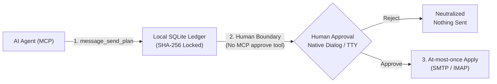

<div align="center">
  
  <h1>Kirje</h1>
  <p><strong>The Safe, Local-First Email CLI &amp; MCP Engine Built for AI Agents</strong></p>
  <p>
    Give Claude Desktop, Cursor, Zed, and autonomous agents safe access to your real inbox.<br />
    Zero cloud relay. Immune to prompt injection. Native 163 / QQ / Gmail / IMAP support.
  </p>

  <p>
    <a href="https://github.com/iiwish/kirje/actions/workflows/ci.yml"></a>
    <a href="https://github.com/iiwish/kirje/releases"></a>
    <a href="LICENSE"></a>
    
    
  </p>

  <p>
    <a href="#-quick-start-30s">Quick Start</a> •
    <a href="#-the-security-model">Security Model</a> •
    <a href="#-why-kirje">Why Kirje</a> •
    <a href="#-mcp-integration">MCP Tools</a> •
    <a href="docs/agent-guide.md">Agent Guide</a> •
    <a href="README.zh-CN.md">简体中文</a>
  </p>
</div>

---

## ⚡ Why Kirje?

Connecting an LLM directly to your primary email inbox with naive scripts or hosted APIs exposes you to catastrophic risks: **indirect prompt injection** hidden inside an incoming email can trick an agent into exfiltrating sensitive threads, deleting your inbox, or spamming contacts. Meanwhile, most open-source MCP servers store passwords in plaintext JSON and break immediately on non-standard IMAP handshakes (like NetEase 163 or QQ Mail).

**Kirje** re-engineers email access for AI agents from the ground up in Rust:

| Capability | **Kirje (Rust Local Engine)** | Naive Open-Source MCP | Hosted Agent Email APIs |
| :--- | :--- | :--- | :--- |
| **Prompt Injection Defense** | ✅ **Immutable Plan → Approve → Apply** | ❌ None (LLM sends/deletes directly) | ❌ API key only |
| **Privacy & Data Ownership** | ✅ **100% Local-First, zero cloud relay** | ✅ Local | ❌ Routed via 3rd-party cloud |
| **Existing Personal Inbox** | ✅ **Connects to your real accounts** | ✅ Partial | ❌ New domain addresses only |
| **Secret Isolation** | ✅ **`0600` private store (0 OS popups)** | ❌ Plaintext in MCP JSON / env | Cloud API Token |
| **Global & China Mail Quirks** | ✅ **Native RFC 2971 & Coremail fixes** | ❌ Fails 163 / QQ handshakes often | — N/A |
| **Token Efficiency** | ✅ **HTML sanitization + `message_triage`** | ❌ Raw HTML blows up LLM context | Partial |

---

## 🛡️ The Security Model

```text
Agent decides what should happen.
Kirje reports mailbox facts and executes only human-approved operations.
```

Kirje enforces a strict physical boundary between **autonomous planning** and **irreversible execution**:



1. **Untrusted by Default**: Every email body, subject, header, and attachment is explicitly flagged `"untrusted": true` and HTML-sanitized before reaching the LLM.
2. **Physical Authority Separation**: The MCP server exposes **zero approval tools**. An agent can draft and stage an immutable `SendPlan` or `OperationPlan` bound to a SHA-256 digest, but cannot approve it.
3. **Frictionless Human Approval**: Approve plans safely via a native macOS system alert dialog (`kirje send request-approval <id> --apply`) or an interactive human terminal (`kirje send approve <id>`).
4. **Zero-Popup `0600` Secret Store**: Credentials are stored in a private `0600` POSIX-permissioned file (`credentials.toml`)—never passed via CLI flags, never exposed in stdout, and never triggering annoying macOS Keychain password popups when background agents run.

---

## 🚀 Quick Start (30s)

### 1. Install

Requires **Rust 1.95+** (or build from source):

```bash
cargo install --git https://github.com/iiwish/kirje kirje-cli
```

<details>
<summary>Or build from local clone</summary>

```bash
git clone https://github.com/iiwish/kirje.git
cd kirje
cargo build --release
# Binary is at ./target/release/kirje
```

</details>

### 2. Discover & Connect Your Email

Kirje auto-discovers verified endpoints, TLS security, and step-by-step app-password instructions (including NetEase 163/126, QQ/Foxmail, Aliyun, 139, 189, Sina, iCloud, Fastmail, plus custom IMAP/SMTP):

```bash
# Discover safe endpoints & authorization code instructions
kirje account discover you@163.com --pretty

# Register account locally (non-secret config)
kirje account add personal you@163.com

# Store your app password securely (interactive TTY prompt, 0600 file store)
kirje secret set personal

# Verify TLS, IMAP handshake & authentication
kirje account check personal --pretty
```

### 3. One-Click MCP Client Setup

Skip manual JSON editing. Automatically configure Claude Desktop, Cursor, Zed, or Cline in one command:

```bash
# Configure a specific client
kirje mcp install --client claude-desktop
kirje mcp install --client cursor

# Or configure all detected clients at once (use --dry-run to preview)
kirje mcp install --client all
```

---

## ✨ Key Capabilities

### 📥 Smart Inbox Triage (`message_triage`)
Stop burning thousands of tokens reading raw emails one by one. `message_triage` inspects recent messages in a single call, sanitizes content into clean 120-character snippets, and categorizes them into `security_alerts`, `invoices_and_receipts`, `notifications`, `personal_and_direct`, and `newsletters_and_promo`:

```bash
kirje message triage --account personal --limit 15 --pretty
```

### 🖥️ Native System Approval UX
Approve agent-staged emails without manually typing long UUIDs in a terminal:

```bash
# Pops a native macOS confirmation dialog showing sender, recipients & subject
kirje send request-approval <plan-id> --apply
```

### 🗄️ Offline SQLite Index & Thread Graphs
Sync envelope metadata transactionally into a private local SQLite index (`index.sqlite3`). Search offline without network access or credentials, reconstruct deterministic RFC 5322 thread graphs, and safely track deletions via soft tombstones:

```bash
kirje sync run --account personal --mailbox INBOX --pretty
kirje message search-local --account personal --mailbox INBOX --unread true --pretty
kirje message thread --account personal --mailbox INBOX --uid 42 --pretty
```

### 📒 Unified Governed Operation Ledger
Every send, draft, flag mutation, archive, and safe delete (move to `\Trash`, never `EXPUNGE`) runs through `outbox.sqlite3` with atomic claims, 24-hour expiry, crash recovery, and explicit `ambiguous` state tracking—Kirje never blindly retries failed network writes.

---

## 🤖 MCP Integration

Start the protocol-clean stdio server manually with `kirje mcp serve` (diagnostics go strictly to `stderr`; `stdout` emits only JSON-RPC).

Kirje exposes **26 task-level MCP tools**:

<details>
<summary>View all 26 MCP tools</summary>

| Category | Tools | Safety Boundary |
| :--- | :--- | :--- |
| **Discovery & Health** | `account_discover`, `account_status`, `index_status`, `system_status` | Read-only / No credentials |
| **Mailbox & Reading** | `mailbox_list`, `message_search`, `message_read`, `message_triage`, `attachment_read` | Remote read-only (`BODY.PEEK`), output marked `untrusted` |
| **Local Sync & Search** | `mailbox_sync`, `message_search_local`, `message_thread` | Local SQLite metadata only |
| **Private Drafts** | `draft_create`, `draft_status`, `draft_update`, `draft_list`, `draft_discard` | Private local ledger only |
| **Governed Send** | `message_send_plan`, `message_send_plan_draft`, `message_send_status`, `message_send_apply` | Plan/Apply only (**no approve tool**) |
| **Governed Operations** | `mail_operation_plan`, `mail_operation_status`, `mail_operation_list`, `mail_operation_apply`, `mail_operation_audit` | Plan/Apply only (**no approve tool**) |

</details>

For autonomous agents, an installable Agent Skill is included at [`skills/kirje/SKILL.md`](skills/kirje/SKILL.md), along with operational rules in [`docs/agent-guide.md`](docs/agent-guide.md).

---

## 🏗️ Workspace Architecture

```text
crates/
├── kirje-core        # Provider-neutral domain contracts, bounds, triage & presets
├── kirje-protocol    # IMAP / SMTP / JMAP adapters (RFC 2971 & Coremail fixes)
├── kirje-credential  # Private 0600 FileSecretStore & OS keyring abstraction
├── kirje-local-io    # Safe atomic file I/O & symlink/boundary guards
├── kirje-store       # Transactional SQLite index, sync cursors & unified ledger
├── kirje-runtime     # Shared application services for CLI and MCP
├── kirje-mcp         # Typed stdio MCP server (26 tools)
└── kirje-cli         # The `kirje` binary & versioned JSON envelope
website/              # Official Astro + Tailwind landing page
docs/                 # Architecture, security, compatibility & conformance specs
```

---

## 🛠️ Development & Verification

```bash
cargo fmt --all --check
cargo clippy --workspace --all-targets --all-features -- -D warnings
cargo test --workspace --all-features --locked
cargo build --workspace --all-features --locked
cargo deny check
```

See [docs/architecture.md](docs/architecture.md), [docs/security.md](docs/security.md), [docs/compatibility.md](docs/compatibility.md), and [docs/conformance.md](docs/conformance.md) for deep technical specifications.

---

## 📄 License & Contributing

Kirje is open-source software licensed under the [Apache-2.0 License](LICENSE).
Contributions are welcome! Please review [CONTRIBUTING.md](CONTRIBUTING.md) and [SECURITY.md](SECURITY.md) before opening a pull request.
