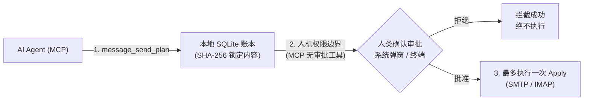

<div align="center">
  
  <h1>Kirje</h1>
  <p><strong>为 AI Agent 而生的安全、本地优先邮件引擎（CLI &amp; MCP Server）</strong></p>
  <p>
    让 Claude Desktop、Cursor、Zed 与自主 Agent 安全接管你的真实邮箱。<br />
    零云端中继 · 彻底免疫 Prompt 注入 · 原生适配 163 / QQ / Gmail / 企业 IMAP
  </p>

  <p>
    <a href="https://github.com/iiwish/kirje/actions/workflows/ci.yml"></a>
    <a href="https://github.com/iiwish/kirje/releases"></a>
    <a href="LICENSE"></a>
    
    
  </p>

  <p>
    <a href="https://kirje.app">官网 (kirje.app)</a> •
    <a href="#-30-秒极速上手">快速上手</a> •
    <a href="#-安全防线与架构设计">安全防线</a> •
    <a href="#-为什么选择-kirje">核心对比</a> •
    <a href="#-mcp-工具集">MCP 工具</a> •
    <a href="docs/agent-guide.md">Agent 指南</a> •
    <a href="README.md">English</a>
  </p>
</div>

---

## ⚡ 为什么选择 Kirje？

直接用普通脚本或云端代理把个人主力邮箱接入大模型存在巨大隐患：藏在来信中的**间接 Prompt 注入**一旦触发，Agent 就可能把你的历史机密邮件转发给黑客，或者清空收件箱。同时，社区大多数简易 MCP 将密码明文写在配置文件里，且遇到网易 163、QQ 邮箱的特殊 IMAP 握手协议时频频报错。

**Kirje** 使用 Rust 从底层彻底重构了面向 AI Agent 的邮件基础设施：

| 核心维度 | **Kirje (Rust 本地引擎)** | 开源简易 IMAP MCP | 云端托管 Agent 邮箱 |
| :--- | :--- | :--- | :--- |
| **防 Prompt 注入拦截** | ✅ **不可变 Plan → Approve → Apply** | ❌ 无防线，LLM 可直接发信/删信 | ❌ 仅 API Key 鉴权 |
| **数据隐私与控制权** | ✅ **100% 本地运行，零云端中继** | ✅ 本地运行 | ❌ 邮件全量经过第三方云端 |
| **接管已有主力邮箱** | ✅ **直接接入存量个人/企业邮箱** | ✅ 支持部分 | ❌ 仅能分配新域名地址 |
| **凭证隔离与弹窗体验** | ✅ **`0600` 私有文件存储（零弹窗）** | ❌ 密码明文写在 MCP JSON 中 | 云端 API Token |
| **国内邮箱握手适配** | ✅ **原生修复 RFC 2971 & Coremail** | ❌ 163 / QQ 经常连接被拒 | — 不适用 |
| **上下文 Token 优化** | ✅ **HTML 清洗脱水 + 一键早报分类** | ❌ 原始 HTML 极易撑爆上下文 | 部分支持 |

---

## 🛡️ 安全防线与架构设计

```text
Agent 负责决定要做什么；
Kirje 负责汇报客观邮件事实，并仅执行经人类批准的操作。
```

Kirje 在架构上将**「自动化起草/规划」**与**「不可逆写操作执行」**在物理边界上彻底隔离：



1. **默认不可信（Untrusted by Default）**：所有邮件正文、主题、链接与附件均强制标记 `"untrusted": true`，并自动完成 HTML 安全清洗。
2. **物理权限分离**：MCP 服务端**绝不暴露任何 Approve 工具**。Agent 可以创建带 SHA-256 摘要锁定的发送或操作计划（Plan），但永远无法自行批准。
3. **低摩擦人机审批**：支持通过 macOS 原生系统弹窗一键审批（`kirje send request-approval <id> --apply`），也支持终端输入 ID 确认（`kirje send approve <id>`）。
4. **零弹窗 `0600` 私有凭证仓**：凭证保存在严格 `0600` POSIX 权限的私有文件（`credentials.toml`）中——绝不通过命令行参数传递密码，绝不在 stdout 输出凭证，也彻底消除后台 Agent 运行时反复弹出的 macOS 钥匙串密码弹窗。

---

## 🚀 30 秒极速上手

### 1. 安装

需要 **Rust 1.95+** 环境：

```bash
cargo install --git https://github.com/iiwish/kirje kirje-cli
```

<details>
<summary>或者从源码克隆编译</summary>

```bash
git clone https://github.com/iiwish/kirje.git
cd kirje
cargo build --release
# 编译产物位于 ./target/release/kirje
```

</details>

### 2. 探测并绑定你的邮箱

Kirje 内置网易 163/126/Yeah、QQ/Foxmail、阿里云、移动 139、电信 189、新浪、iCloud、Fastmail 等预设（同时支持任意自建 IMAP/SMTP），并自动返回客户端授权码开启路径指引：

```bash
# 自动探测服务商端口与授权码获取指引
kirje account discover you@163.com --pretty

# 在本地保存账号配置（不含密钥）
kirje account add personal you@163.com

# 交互式加密写入授权码（写入 0600 私有仓，零系统弹窗）
kirje secret set personal

# 验证 TLS 连通性与 IMAP/SMTP 握手认证
kirje account check personal --pretty
```

### 3. 一键接入主流 AI 客户端

告别手动翻找 JSON 配置文件，一条命令自动配置 Claude Desktop、Cursor、Zed 与 Cline：

```bash
# 为指定客户端注入 MCP 配置
kirje mcp install --client claude-desktop
kirje mcp install --client cursor

# 或者一次性扫描并配置全部主流客户端（可加 --dry-run 预览）
kirje mcp install --client all
```

---

## ✨ 核心特性

### 📥 Agent 专属智能早报（`message_triage`）
告别让 Agent 一封封读取冗长邮件的高昂 Token 开销。单次调用 `message_triage` 即可自动抓取最新邮件、清洗提取 120 字符纯文本摘要，并智能归类为 `security_alerts`（验证码/安全警告）、`invoices_and_receipts`（发票/账单）、`notifications`（通知）、`personal_and_direct`（个人/工作沟通）和 `newsletters_and_promo`（订阅推广）：

```bash
kirje message triage --account personal --limit 15 --pretty
```

### 🖥️ 原生系统弹窗审批（免敲终端长 ID）
Agent 生成发信计划后，直接唤起 macOS 原生警报弹窗，点击「批准发送」即可完成签字并投递：

```bash
kirje send request-approval <plan-id> --apply
```

### 🗄️ 离线 SQLite 索引与确定性会话图
将信封元数据事务性同步至本地 SQLite（`index.sqlite3`）。无需联网与凭证即可秒级检索历史邮件、重建 RFC 5322 会话脉络，并通过软删除墓碑追踪状态变更：

```bash
kirje sync run --account personal --mailbox INBOX --pretty
kirje message search-local --account personal --mailbox INBOX --unread true --pretty
kirje message thread --account personal --mailbox INBOX --uid 42 --pretty
```

### 📒 统一事务级操作账本
所有发信、草稿、标星、归档与安全删信（默认移至 `\Trash`，绝不直接 `EXPUNGE`）均记录在 `outbox.sqlite3` 中，具备原子认领、24 小时过期、崩溃恢复与 `ambiguous` 不确定态标记——绝不盲目自动重试。

---

## 🤖 MCP 工具集

可使用 `kirje mcp serve` 启动协议纯净的 stdio MCP 服务（诊断日志仅输出至 `stderr`，`stdout` 严格保持 JSON-RPC 纯净）。

Kirje 共提供 **26 个任务级 MCP 工具**：

<details>
<summary>查看全部 26 个 MCP 工具清单</summary>

| 模块分类 | 工具名称 | 安全边界 |
| :--- | :--- | :--- |
| **探测与状态** | `account_discover`, `account_status`, `index_status`, `system_status` | 只读 / 无凭证访问 |
| **邮箱与读信** | `mailbox_list`, `message_search`, `message_read`, `message_triage`, `attachment_read` | 远程只读（`BODY.PEEK`），强制标记 `untrusted` |
| **离线同步与检索** | `mailbox_sync`, `message_search_local`, `message_thread` | 仅操作本地 SQLite 元数据 |
| **本地私有草稿** | `draft_create`, `draft_status`, `draft_update`, `draft_list`, `draft_discard` | 仅操作本地私有账本 |
| **受控发信** | `message_send_plan`, `message_send_plan_draft`, `message_send_status`, `message_send_apply` | 仅限 Plan 与 Apply（**无 Approve 工具**） |
| **受控邮箱操作** | `mail_operation_plan`, `mail_operation_status`, `mail_operation_list`, `mail_operation_apply`, `mail_operation_audit` | 仅限 Plan 与 Apply（**无 Approve 工具**） |

</details>

项目同时内置了可直接安装的 Agent Skill：[`skills/kirje/SKILL.md`](skills/kirje/SKILL.md)，以及面向自主 Agent 的行为规范：[`docs/agent-guide.md`](docs/agent-guide.md)。

---

## 🏗️ 工程架构

```text
crates/
├── kirje-core        # 服务商中立的领域契约、安全边界、早报分类与邮箱预设
├── kirje-protocol    # IMAP / SMTP / JMAP 协议适配器（含 RFC 2971 与 Coremail 修复）
├── kirje-credential  # 0600 私有文件凭证仓与系统钥匙串抽象
├── kirje-local-io    # 安全原子文件读写与路径/软链接防护
├── kirje-store       # 事务级 SQLite 元数据索引、游标与统一操作账本
├── kirje-runtime     # 驱动 CLI 与 MCP 的统一应用服务层
├── kirje-mcp         # 强类型 stdio MCP 服务（26 个工具）
└── kirje-cli         # `kirje` 二进制入口与版本化 JSON 输出信封
website/              # 官方 Astro + Tailwind 介绍官网源码
docs/                 # 架构、安全模型、兼容性契约与一致性规范文档
```

---

## 🛠️ 本地开发与校验

```bash
cargo fmt --all --check
cargo clippy --workspace --all-targets --all-features -- -D warnings
cargo test --workspace --all-features --locked
cargo build --workspace --all-features --locked
cargo deny check
```

更多技术细节请参阅 [架构文档](docs/architecture.md)、[安全规范](docs/security.md)、[兼容性契约](docs/compatibility.md) 与 [协议一致性说明](docs/conformance.md)。

---

## 📄 开源协议与贡献

Kirje 基于 [Apache-2.0 协议](LICENSE) 开源。欢迎提交 Issue 与 Pull Request，贡献前请阅读 [CONTRIBUTING.md](CONTRIBUTING.md) 与 [SECURITY.md](SECURITY.md)。
