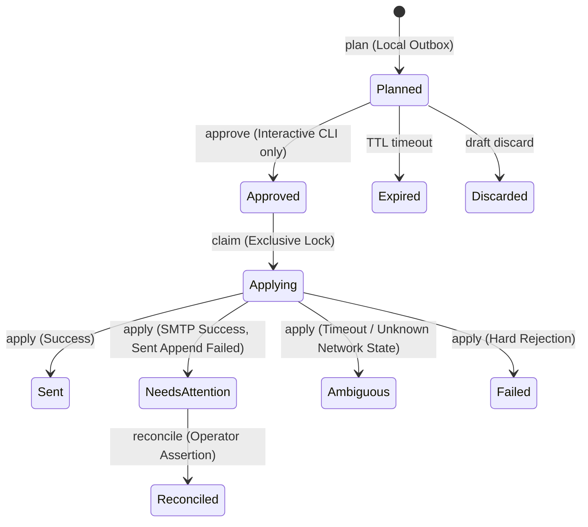

# Kirje 1.x 稳定契约与兼容性策略 (Compatibility Policy)

本文档定义了 Kirje 1.x 版本的公共契约、版本矩阵、升级迁移保证、降级拦截策略以及备份与灾备恢复标准流程（遵循 FR-018 ~ FR-021 规范）。

---

## 1. 1.x 版本矩阵 (Version Matrix)

| 契约组件 | 标识 / 版本 | 规范与保证 |
| --- | --- | --- |
| **Kirje 发布版本** | `1.0.0` (Semantic Versioning) | 1.x 生命周期内遵循语义化版本，保证不发生破坏性接口破坏。 |
| **JSON 命令信封** | `contract_version: "2026-09-04.1"` | CLI 与 MCP 通用的根 JSON 信封结构（包含 `contract_version`, `ok`, `data` / `error`）。 |
| **退出代码 (Exit Codes)** | `0`, `1`, `2` | `0`: 成功；`1`: 运行时执行失败/业务拒绝；`2`: 命令行输入无效/格式不合法。 |
| **MCP 工具契约** | `25 个受控工具` (RMCP Server) | 包含 25 个类型安全的任务级工具，完全禁止审批工具（严防提权绕过）。 |
| **权威存储 (Authority Store)** | `application_id = 1263096394`<br>`user_version = 1` | 严格保证单所有者非对称签名锚点与信任根。 |
| **本地邮箱索引 (Mailbox Index)** | `user_version = 2` | 包含增量游标、软删除 Tombstones、线程图索引与分页排序。 |
| **统一发件与操作账本 (Outbox Ledger)** | `user_version = 3` | 包含两阶段审批、幂等申领、不可变审计轨迹、`needs_attention` 与 `reconciled` 对账状态。 |

---

## 2. 兼容性与演化规则 (Evolution Rules)

### 2.1 向前与向后兼容性
- **增量字段兼容**：在 1.x 期间，任何新增的输出字段均作为可选字段（Optional Fields）提供，不得破坏既有解析器。
- **输入参数校验**：所有外部输入（CLI 参数、JSON 输入、MCP 参数）必须经过有界严格校验，超长或结构不符的内容在解析前即刻被拦截（退出码 2 或 `invalid_input`）。
- **稳定错误码**：错误目录中的枚举编码（如 `unsupported_capability`, `send_plan_state`, `secret_missing` 等）保持语义不变，且重试元数据（`retryable: bool`）严格遵循错误类型的确定性判定。
- **废弃周期**：任何计划废弃的接口必须至少提前一个次版本（Minor Release）进行文档公告与报警，严禁未通知即下线。

### 2.2 降级拒绝策略 (Downgrade Rejection)
所有 SQLite 存储组件在启动时必须检查 `PRAGMA user_version`：
- 若 `user_version > SCHEMA_VERSION`：判定数据库由更高版本的 Kirje 写入，**立即拒绝启动并报错**（`StoreMigration` 或 `UnsupportedCapability`），绝不尝试重写或降级，防止元数据破坏。
- 若 `user_version == SCHEMA_VERSION`：直接平滑打开。
- 若 `user_version < SCHEMA_VERSION`：在严格的排他事务中依次执行幂等迁移批处理。

---

## 3. 操作状态机 (Operation State Machine)

发件与远程邮箱操作遵循不可变的状态机生命周期：



- **申领排他性**：`Applying` 状态使用行锁与时间戳保护，杜绝并发竞争。
- **不确定性保护**：发生超时或崩溃的动作转入 `Ambiguous`，**绝不自动重试发件或变更**。
- **对账流转**：邮件已送达但未能存入发件箱时转入 `NeedsAttention`，必须经由人工介入并通过 CLI `kirje send reconcile` 记录不可变断言。

---

## 4. 能力发现与错误分类 (Capability Discovery)

Kirje 运行时将操作能力与错误原因划分为 4 类明确可区分的状态：

1. **协议不支持 (Unsupported)**：
   - 特性在当前 1.0 协议层未实现（如 JMAP 或 OAuth2 认证）。
   - 返回错误：`MailErrorCode::UnsupportedCapability`，`retryable: false`。
2. **策略禁止 (Disabled by Policy)**：
   - 账户策略配置了只读模式（`allow_remote_write: false`）或受限于收件人/邮箱白名单。
   - 返回错误：`MailErrorCode::UnsupportedCapability`（明确提示 policy 限制），`retryable: false`。
3. **远端不可用 (Unavailable from Provider)**：
   - 远端服务器没有声明相应的能力扩展（例如 IMAP 服务器未声明 `SPECIAL-USE` 或 `MOVE`）。
   - 返回错误：`MailErrorCode::RemoteCapabilityIncomplete`，`retryable: false`。
4. **临时失败 (Temporary Failure)**：
   - 瞬时网络中断、连接超时或服务端临时忙（421/451）。
   - 返回错误：`MailErrorCode::Network` 或 `MailErrorCode::Tls`，`retryable: true`。

---

## 5. 备份与灾难恢复规程 (Backup & Disaster Recovery)

### 5.1 受管资产清单
- **账户策略配置**：`~/.config/kirje/accounts.toml`
- **本地邮箱索引**：`~/.local/share/kirje/index.sqlite3`
- **发件与操作账本**：`~/.local/share/kirje/outbox.sqlite3`
- **本地权威证书**：`~/.local/share/kirje/authority.sqlite3`

### 5.2 安全备份步骤
由于 Kirje 数据库采用 WAL 模式运行，执行冷备份或热备份必须保证文件完整性：

```bash
# 1. 确保目录安全权限 (0700)
mkdir -p -m 0700 ~/kirje-backup-$(date +%Y%m%d)

# 2. 备份 accounts.toml
cp -p ~/.config/kirje/accounts.toml ~/kirje-backup-$(date +%Y%m%d)/

# 3. 对 SQLite 执行一致性导出 (使用 sqlite3 vacuum into 或安全复制 wal)
sqlite3 ~/.local/share/kirje/index.sqlite3 "VACUUM INTO '~/kirje-backup-$(date +%Y%m%d)/index.sqlite3';"
sqlite3 ~/.local/share/kirje/outbox.sqlite3 "VACUUM INTO '~/kirje-backup-$(date +%Y%m%d)/outbox.sqlite3';"
sqlite3 ~/.local/share/kirje/authority.sqlite3 "VACUUM INTO '~/kirje-backup-$(date +%Y%m%d)/authority.sqlite3';"

# 4. 强制备份文件的严格权限 (0600)
chmod 0600 ~/kirje-backup-$(date +%Y%m%d)/*
```

### 5.3 灾难恢复与完整性校验
在系统迁移或损坏恢复时：
1. 将备份文件还原至目标目录（确保归属用户一致且权限为 `0600`）。
2. 使用 `PRAGMA integrity_check` 校验数据库物理结构：
   ```bash
   sqlite3 ~/.local/share/kirje/index.sqlite3 "PRAGMA integrity_check;"
   sqlite3 ~/.local/share/kirje/outbox.sqlite3 "PRAGMA integrity_check;"
   sqlite3 ~/.local/share/kirje/authority.sqlite3 "PRAGMA integrity_check;"
   ```
3. 运行诊断工具验证运行时就绪状态：
   ```bash
   kirje doctor --pretty
   ```
